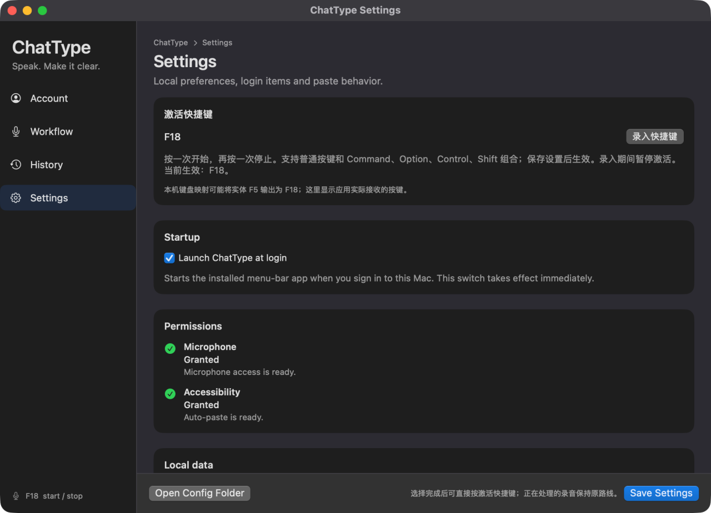

# Activation shortcut · build 143

Settings → 激活快捷键 now records a key with optional Command, Option, Control and Shift modifiers. Capture pauses activation. Escape, focus loss, section changes and closing the window restore the previous shortcut. Save Settings applies the candidate immediately; an unsuccessful registration or write retains the previous binding. Workflow auto-apply leaves a pending shortcut uncommitted. The sidebar shows the applied binding.

On the enrolled Mac, physical F5 produces F18, so Settings displays F18 with a local-mapping explanation. Custom keycodes and modifiers survive the installer. No transcription or polish provider is changed by this feature.

## Independent Fn arrangement

The owner chose short Fn to open the official ChatGPT app and held Fn to use the native Doubao input method. This is a separately enrolled local Karabiner rule. A lazy Fn passes combinations through, a tap opens `/Applications/ChatGPT.app`, and a hold emits Fn. The tap timeout and hold threshold both come from the explicit `fnSplit.holdMilliseconds` preference, configured as 300 ms on this Mac. [Karabiner’s documented modifier pattern](https://karabiner-elements.pqrs.org/docs/json/typical-complex-modifications-examples/#post-escape-if-left_control-is-pressed-alone) supplies this behavior.

No Fn rule is added for an unenrolled machine. Absence of `fnSplit` leaves existing rules alone; disabling a previously installed split requires removing the single rule named `ChatType local keyboard: Fn tap ChatGPT, hold Doubao`.

## Verification

- Implemented: recorder, transactional registration, pending/applied distinction and installation preservation.
- Checked: source harness passed 387 Swift tests, 42 Python tests, shell/policy/landing-page checks. The five targeted shortcut tests cover legacy decoding, persistence, replacement failure, capture lifecycle and workflow auto-apply.
- Reviewed: native Codex independent automatic code review of `62f300b` completed with no actionable P0–P2 findings. Its conclusions cover the final source candidate; later changes only update documentation and the installed screenshot.
- Packaged: build 143; Developer ID signature and packaged-app metadata verified.
- Installed: `/Applications/ChatType.app`, build 143.
- Live Settings: official Computer Use recorded Control + Option + Shift + K, saved it, read back the applied label and persisted configuration, and cancelled a new capture with Escape. The temporary binding was restored to physical F5 / internal F18 before closeout. The tool cannot send F18 in the background, so restoration used the supported configuration and reinstall path; this is not recorded as a second recorder acceptance.
- Fn configuration: official Karabiner lint passed; active Default profile and the exclusive tap/hold rule were read back. Physical short/long Fn behavior awaits the owner’s actual keyboard result; app-directed synthetic events do not establish it.
- Left running: normal installed menu-bar runtime; Settings retained for review.

The first installed launch spent roughly two minutes restoring existing history snapshots before showing Settings. A process sample identified the existing recovery scan; no history was deleted or moved.

[Before Settings](images/shortcut-settings-before-143.png)
